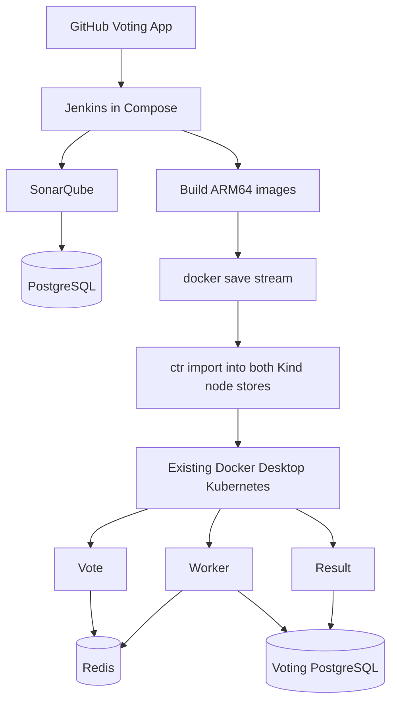

# Architecture

Context: `docker-desktop`; nodes: `desktop-control-plane`, `desktop-worker`; Kubernetes v1.36.1; containerd 2.3.1; ARM64.

The pipeline assumes node containers are visible to Docker and expose `ctr`. Setup preflight checks Docker visibility. No cluster creation or deletion is performed.
